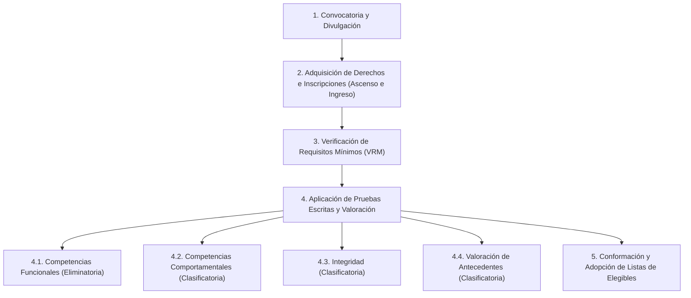
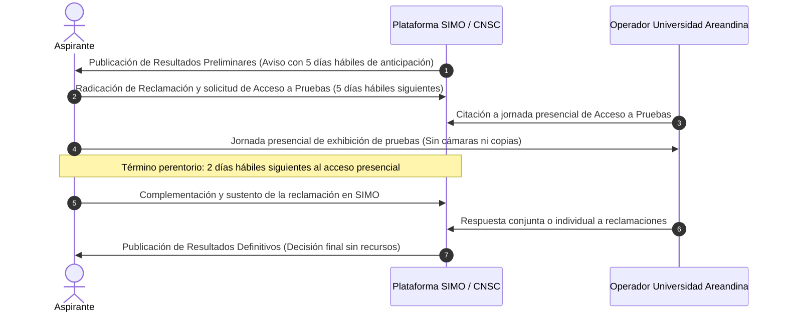

# Guía de Orientación al Aspirante (GOA): Presentación de Pruebas Escritas - Proceso de Selección DIAN 2676

**Entidades Convocantes:** Comisión Nacional del Servicio Civil (CNSC) & Dirección de Impuestos y Aduanas Nacionales (DIAN)  
**Operador Técnico Evaluador:** Fundación Universitaria del Área Andina (FUAA)  
**Marco Contractual:** Proceso CNSC-PAMC 006 de 2026 / Contrato de Prestación de Servicios No. 489 de 2026  
**Fecha de Publicación de la Guía:** Octubre de 2026  
**Fecha Oficial de Aplicación de Pruebas Escritas:** Domingo, 8 de noviembre de 2026  
**Régimen Aplicable:** Sistema Específico de Carrera de la DIAN (Decreto Ley 071 de 2020 y Decreto Ley 927 de 2023)  
**Actos Administrativos Reguladores:** Acuerdo No. 21 del 07 de noviembre de 2025 y su Anexo Técnico

---

## Tabla de Contenido
1. [Siglas y Terminología](#1-siglas-y-terminología)
2. [Presentación y Alcance del Documento](#2-presentación-y-alcance-del-documento)
3. [Marco Normativo y Regla de Corte Temporal](#3-marco-normativo-y-regla-de-corte-temporal)
4. [Reserva, Confidencialidad y Propiedad de las Pruebas](#4-reserva-confidencialidad-y-propiedad-de-las-pruebas)
5. [Estructura del Proceso y Generalidades de las Pruebas](#5-estructura-del-proceso-y-generalidades-de-las-pruebas)
6. [Ponderaciones, Carácter y Puntajes Aprobatorios por Modalidad](#6-ponderaciones-carácter-y-puntajes-aprobatorios-por-modalidad)
7. [Ejes Temáticos e Indicadores de Evaluación](#7-ejes-temáticos-e-indicadores-de-evaluación)
8. [Metodología de Evaluación y Formato de Ítems](#8-metodología-de-evaluación-y-formato-de-ítems)
   - 8.1. Pruebas de Competencias Funcionales (PJS)
   - 8.2. Banco Oficial de Preguntas Modelo con Justificación Razonada
   - 8.3. Pruebas de Competencias Comportamentales e Integridad (Escala Likert)
   - 8.4. Subescalas de Control y Validez Psicométrica
9. [Instrucciones de Diligenciamiento y Hojas de Respuestas](#9-instrucciones-de-diligenciamiento-y-hojas-de-respuestas)
10. [Logística, Citación, Horarios y Sedes de Aplicación](#10-logística-citación-horarios-y-sedes-de-aplicación)
11. [Documentos de Identificación Válidos](#11-documentos-de-identificación-válidos)
12. [Elementos Permitidos, Restricciones y Régimen Disciplinario](#12-elementos-permitidos-restricciones-y-régimen-disciplinario)
13. [Causales de Invalidación de Pruebas y Exclusión del Proceso](#13-causales-de-invalidación-de-pruebas-y-exclusión-del-proceso)
14. [Protocolo de Ajustes Razonables para Aspirantes con Discapacidad](#14-protocolo-de-ajustes-razonables-para-aspirantes-con-discapacidad)
15. [Publicación de Resultados, Acceso a Pruebas y Reclamaciones](#15-publicación-de-resultados-acceso-a-pruebas-y-reclamaciones)
16. [Medidas de Salubridad y Emergencias](#16-medidas-de-salubridad-y-emergencias)

---

## 1. Siglas y Terminología

| Sigla / Término | Definición y Significado Oficial |
| :--- | :--- |
| **CNSC** | Comisión Nacional del Servicio Civil. |
| **DIAN** | Unidad Administrativa Especial Dirección de Impuestos y Aduanas Nacionales. |
| **SIMO** | Sistema de apoyo para la Igualdad, el Mérito y la Oportunidad. Plataforma tecnológica oficial del proceso. |
| **FUAA** | Fundación Universitaria del Área Andina (operador técnico universitario contratado por la CNSC). |
| **VRM** | Verificación de Requisitos Mínimos. |
| **MERF** | Manual Específico de Requisitos y Funciones de la DIAN. |
| **PJS** | Prueba de Juicio Situacional (metodología evaluativa basada en casos, problemas y tareas reales del contexto institucional). |
| **GOA** | Guía de Orientación al Aspirante. |
| **Acuerdo del Proceso** | Acuerdo No. 21 del 07 de noviembre de 2025 expedido por la CNSC. |
| **Anexo del Acuerdo** | Anexo Técnico del Acuerdo No. 21 del 07 de noviembre de 2025. |

---

## 2. Presentación y Alcance del Documento

En el marco del Contrato de Prestación de Servicios No. 489 de 2026 suscrito entre la CNSC y la Fundación Universitaria del Área Andina (FUAA), cuyo objeto contractual comprende:

> *"REALIZAR LA VERIFICACIÓN DE REQUISITOS MÍNIMOS Y LAS PRUEBAS ESCRITAS DEL PROCESO DE SELECCIÓN EN LAS MODALIDADES DE ASCENSO E INGRESO PARA PROVEER EMPLEOS EN VACANCIA DEFINITIVA PERTENECIENTES AL SISTEMA ESPECÍFICO DE CARRERA ADMINISTRATIVA DE LA PLANTA DE PERSONAL DE LA UNIDAD ADMINISTRATIVA ESPECIAL DIRECCIÓN DE IMPUESTOS Y ADUANAS NACIONALES – DIAN, PROCESO DE SELECCIÓN DIAN 2676"*.

### 2.1. Objetivos de la Guía
* Brindar directrices técnicas, conceptuales y logísticas a los aspirantes admitidos tras la fase de VRM.
* Explicar los tipos de pruebas, criterios de ponderación, estructura psicométrica de las preguntas y procedimientos del día de aplicación.
* Definir las pautas de diligenciamiento de la hoja de respuestas, causales de exclusión/invalidación y el protocolo de reclamaciones.

> [!NOTE]
> La Guía de Orientación tiene carácter estrictamente orientador e ilustrativo. No sustituye ni modifica lo regulado en el Acuerdo No. 21 de 2025 y su Anexo Técnico. En caso de discrepancia, prevalecerá la información oficial publicada en SIMO y en el portal web institucional de la CNSC.

---

## 3. Marco Normativo y Regla de Corte Temporal

### 3.1. Regla de Corte Normativo Crítica (Vigencia de Leyes y Reglamentos Evaluados)
> [!IMPORTANT]
> **REGLA DE ORO DE CORTE JURÍDICO:**  
> Para todos los ejes temáticos o indicadores funcionales sustentados en fuentes jurídicas (Leyes, Decretos, Resoluciones, Circulares, Manuales, Jurisprudencia), **únicamente se evaluarán aquellas normas que se encuentren vigentes y hayan sido expedidas antes del 19 de junio de 2026**. Modificaciones normativas expedidas con posterioridad a dicha fecha no serán objeto de evaluación.

### 3.2. Fuentes Normativas Aplicables al Proceso
Conforme al artículo 5 del Acuerdo No. 21 de 2025 y el artículo 32 del Decreto Ley 927 de 2023:
1. **Constitución Política de Colombia de 1991**.
2. **Ley 909 de 2004** y sus decretos reglamentarios (en lo no contemplado por el sistema específico).
3. **Decreto Ley 760 de 2005** (Procedimiento de reclamaciones y facultades CNSC).
4. **Decreto Ley 770 de 2005**.
5. **Ley 1033 de 2006**.
6. **Decreto 1083 de 2015** (Decreto Único Reglamentario del Sector Función Pública, aplicable en materias no reguladas por el Decreto Ley 927 de 2023).
7. **Ley 1955 de 2019**.
8. **Decreto 498 de 2020**.
9. **Leyes 2039 y 2043 de 2020** (Equiparación de experiencia y pasantías).
10. **Leyes 2113 y 2119 de 2021**.
11. **Ley 2221 de 2022**.
12. **Decreto 952 de 2021**.
13. **Ley 2214 de 2022**.
14. **Decreto 610 del 10 de octubre de 2022** (Gobernación del Archipiélago de San Andrés, Providencia y Santa Catalina - OCCRE).
15. **Decreto Ley 927 de 2023** (Modifica y adiciona el Sistema Específico de Carrera de la DIAN establecido en el Decreto Ley 071 de 2020).
16. **Ley 2418 de 2024**.
17. **Resolución No. 1197 de 2024** del Ministerio de Salud y Protección Social.
18. **Resolución DIAN No. 067 de 2024** (Adopción del Manual Específico de Requisitos y Funciones - MERF).
19. **Resolución DIAN No. 065 de 2024** (Diccionario de Competencias Comportamentales de la DIAN).
20. **Resolución DIAN No. 066 de 2024**.
21. **Resolución DIAN No. 059 de 2017**.
22. Demás normas concordantes, complementarias y vigentes expedidas antes del 19 de junio de 2026.

---

## 4. Reserva, Confidencialidad y Propiedad de las Pruebas

* **Propiedad Patrimonial:** De conformidad con el numeral 5.4 del Anexo del Acuerdo, el material de las pruebas escritas es propiedad patrimonial exclusiva de la CNSC.
* **Carácter Reservado:** El artículo 31 de la Ley 909 de 2004 consagra que las pruebas aplicadas o por aplicar en los procesos de selección tienen carácter estrictamente reservado. Solo podrán ser conocidas por las personas autorizadas por la CNSC durante la tramitación de reclamaciones y revisión presencial.
* **Prohibición de Reproducción:** Queda terminantemente prohibida la copia, reproducción, toma de fotografías, digitalización, sustracción física o divulgación digital del cuadernillo, la hoja de respuestas o las hojas de operaciones. Su infracción acarrea sanciones administrativas, anulación, exclusión del concurso y acciones penales por delito contra la reserva legal.

---

## 5. Estructura del Proceso y Generalidades de las Pruebas

Conforme al artículo 3 del Acuerdo del Proceso de Selección, el concurso comprende las siguientes etapas secuenciales:



### 5.1. Propósito y Definición de las Pruebas Escritas
Conforme al artículo 17 del Acuerdo y numeral 32.3 del artículo 32 del Decreto Ley 927 de 2023:

1. **Prueba Escrita de Competencias Funcionales:**
   - **Objeto:** Evalúa habilidades y conocimientos aplicados que debe dominar el servidor de la UAE DIAN para ejercer con eficiencia y calidad las funciones asignadas a su empleo según el MERF.
   - **Metodología:** Pruebas de Juicio Situacional (PJS).
   - **Carácter:** **ELIMINATORIO**. Exige un puntaje mínimo de **70,00 sobre 100,00**.
2. **Prueba Escrita de Competencias Comportamentales:**
   - **Objeto:** Evalúa atributos individuales, conductas observables y actitudes conductuales que determinan el desempeño idóneo y la interacción con equipos y usuarios, en armonía con el Diccionario de Competencias de la DIAN (Resolución 065 de 2024).
   - **Metodología:** Autoinforme en escala Likert (4 niveles).
   - **Carácter:** **CLASIFICATORIO**.
3. **Prueba Escrita de Integridad:**
   - **Objeto:** Evalúa la adopción de los valores públicos fundamentales, el apego al Código de Integridad de la DIAN (CG-TAH-0002) y la coherencia conductual frente a dilemas de probidad y servicio.
   - **Metodología:** Autoinforme en escala Likert (4 niveles).
   - **Carácter:** **CLASIFICATORIO**.

---

## 6. Ponderaciones, Carácter y Puntajes Aprobatorios por Modalidad

Las tablas oficiales que determinan el peso de cada prueba sobre el total del concurso (100%) son:

### 6.1. Modalidad INGRESO

#### A. Empleos que REQUIEREN experiencia (Asistencial, Técnico y Profesional)
| Prueba | Carácter | Peso Porcentual | Puntaje Mínimo Aprobatorio |
| :--- | :---: | :---: | :---: |
| **Competencias Funcionales** | **Eliminatorio** | **65%** | **70.00** |
| **Competencias Comportamentales** | Clasificatorio | 15% | No aplica |
| **Integridad** | Clasificatorio | 10% | No aplica |
| **Valoración de Antecedentes** | Clasificatorio | 10% | No aplica |
| **TOTAL** | | **100%** | |

#### B. Empleos que NO REQUIEREN experiencia (Asistencial, Técnico y Profesional)
| Prueba | Carácter | Peso Porcentual | Puntaje Mínimo Aprobatorio |
| :--- | :---: | :---: | :---: |
| **Competencias Funcionales** | **Eliminatorio** | **70%** | **70.00** |
| **Competencias Comportamentales** | Clasificatorio | 20% | No aplica |
| **Integridad** | Clasificatorio | 10% | No aplica |
| **TOTAL** | | **100%** | |

#### C. Empleos RESERVADOS PARA PERSONAS CON DISCAPACIDAD
| Prueba | Carácter | Peso Porcentual | Puntaje Mínimo Aprobatorio |
| :--- | :---: | :---: | :---: |
| **Competencias Funcionales** | **Eliminatorio** | **65%** | **70.00** |
| **Competencias Comportamentales** | Clasificatorio | 15% | No aplica |
| **Integridad** | Clasificatorio | 10% | No aplica |
| **Valoración de Antecedentes** | Clasificatorio | 10% | No aplica |
| **TOTAL** | | **100%** | |

---

### 6.2. Modalidad ASCENSO

#### A. Empleos que REQUIEREN experiencia (Asistencial, Técnico y Profesional)
| Prueba | Carácter | Peso Porcentual | Puntaje Mínimo Aprobatorio |
| :--- | :---: | :---: | :---: |
| **Competencias Funcionales** | **Eliminatorio** | **60%** | **70.00** |
| **Competencias Comportamentales** | Clasificatorio | 15% | No aplica |
| **Integridad** | Clasificatorio | 10% | No aplica |
| **Valoración de Antecedentes** | Clasificatorio | 15% | No aplica |
| **TOTAL** | | **100%** | |

#### B. Empleos que NO REQUIEREN experiencia (Técnico y Profesional)
| Prueba | Carácter | Peso Porcentual | Puntaje Mínimo Aprobatorio |
| :--- | :---: | :---: | :---: |
| **Competencias Funcionales** | **Eliminatorio** | **65%** | **70.00** |
| **Competencias Comportamentales** | Clasificatorio | 20% | No aplica |
| **Integridad** | Clasificatorio | 10% | No aplica |
| **Valoración de Antecedentes** | Clasificatorio | 5% | No aplica |
| **TOTAL** | | **100%** | |

#### C. Empleos RESERVADOS PARA PERSONAS CON DISCAPACIDAD (Asistencial, Técnico y Profesional)
| Prueba | Carácter | Peso Porcentual | Puntaje Mínimo Aprobatorio |
| :--- | :---: | :---: | :---: |
| **Competencias Funcionales** | **Eliminatorio** | **60%** | **70.00** |
| **Competencias Comportamentales** | Clasificatorio | 15% | No aplica |
| **Valoración de Antecedentes** | Clasificatorio | 15% | No aplica |
| **Integridad** | Clasificatorio | 10% | No aplica |
| **TOTAL** | | **100%** | |

---

## 7. Ejes Temáticos e Indicadores de Evaluación

Los ejes e indicadores representan los constructos temáticos, normativos, procedimentales y conductuales asociados a las funciones de cada empleo:
* Delimitados conjuntamente por la CNSC y la DIAN a partir del MERF (Resolución 067 de 2024).
* Consulta individualizada de ejes por empleo:  
  [http://dian-2676-areandina.com.co/indicadores-dian-2667/](http://dian-2676-areandina.com.co/indicadores-dian-2667/)
* Los indicadores que remitan a normativa se ceñirán al principio de validez jurídica anterior al **19 de junio de 2026**.

---

## 8. Metodología de Evaluación y Formato de Ítems

### 8.1. Pruebas de Competencias Funcionales: Prueba de Juicio Situacional (PJS)
El formato evalúa la aplicación práctica de conocimientos en escenarios reales o verosímiles de la gestión en la DIAN.

* **Estructura tripartita del ítem:**
  1. **Caso:** Planteamiento de una situación, incidente, evento o escenario laboral hipotético en el entorno funcional de la DIAN.
  2. **Enunciado:** Tarea, problema o decisión concreta que el aspirante debe abordar en su rol.
  3. **Opciones de Respuesta:** Tres (3) alternativas de acción (`A`, `B`, `C`), donde **una sola (1) es correcta y eficiente** frente al marco normativo y funcional vigente.

---

### 8.2. Banco Oficial de Preguntas Modelo con Justificación Razonada

#### Ejemplo 1: Nivel Profesional (PJS Funcional)

* **Caso:**
  > Al iniciar la planeación de una nueva vigencia, se requiere conocer el estado actual de la gestión del área antes de definir nuevas acciones. La información disponible muestra avances distintos entre los procesos de ingreso, desarrollo y retiro, pero aún no se han identificado de manera ordenada las fortalezas, brechas ni el nivel de madurez alcanzado. Se designa a un profesional para dicha labor con los instrumentos adecuados.
* **Enunciado:**
  > Para diagnosticar el estado de la gestión con base en la información descrita, al profesional le corresponde:
* **Opciones de Respuesta:**
  - **A.** Aplicar la Matriz de Gestión Estratégica del Talento Humano y calificar las variables que la componen.
  - **B.** Consultar el Plan de Acción de Talento Humano y verificar el avance de las actividades de cada proceso.
  - **C.** Revisar el Plan Estratégico de Talento Humano y comparar las actividades programadas con las ejecutadas.

* **Clave Oficial:** **A**
* **Justificación de Respuestas:**
  - **Opción A (CORRECTA):** Conforme al Manual Operativo del Modelo Integrado de Planeación y Gestión (MIPG), el diagnóstico corresponde a la Etapa 2 de la Política de Gestión Estratégica del Talento Humano. La herramienta oficial para dicho fin es la *Matriz de Gestión Estratégica del Talento Humano*, la cual contiene un inventario de variables que ubican a la entidad en un nivel de madurez (básico operativo, transformación o consolidación). Permite identificar brechas y fortalezas antes de diseñar acciones.
  - **Opción B (INCORRECTA):** El Plan de Acción corresponde a la Etapa 3 del MIPG (diseñar acciones), fase posterior al diagnóstico. El seguimiento de avance no constituye un diagnóstico de la gestión frente a la política.
  - **Opción C (INCORRECTA):** El Plan Estratégico de Talento Humano (Decreto 1083 de 2015, art. 2.2.22.3.14, adicionado por Decreto 612 de 2018) es un instrumento de planeación ejecutiva. Comparar lo programado con lo ejecutado mide el grado de cumplimiento de metas, pero no diagnóstica el estado de madurez ni las variables de la política.

---

#### Ejemplo 2: Nivel Técnico (PJS Funcional)

* **Caso:**
  > En el área de talento humano, se revisaron los resultados de una evaluación de competencias laborales, e identificaron brechas entre las competencias requeridas por los empleos y las demostradas por los servidores. Para orientar las acciones de desarrollo, se pide el apoyo de un técnico para procesar esos datos.
* **Enunciado:**
  > Con base en los resultados descritos, el técnico debe entregar la información según:
* **Opciones de Respuesta:**
  - **A.** Las diferencias halladas en la valoración con un consolidado que identifique a las personas.
  - **B.** El puntaje obtenido para facilitar la actividad general de formación para los servidores.
  - **C.** El promedio alcanzado por área con el fin de guiar el orden de las decisiones a tomar.

* **Clave Oficial:** **A**
* **Justificación de Respuestas:**
  - **Opción A (CORRECTA):** Las competencias funcionales son los conocimientos y habilidades requeridas para cumplir las funciones del empleo (Decreto Ley 927 de 2023, art. 58 y 60). El desarrollo busca cerrar brechas individuales frente al nivel exigido (Decreto 1083 de 2015, art. 2.2.18.4.1 num. 3 y art. 2.2.18.4.5). Presentar las brechas individualizadas por persona permite focalizar los planes de desarrollo.
  - **Opción B (INCORRECTA):** Un puntaje global o general oculta las falencias específicas en cada competencia individual, impidiendo cerrar brechas puntuales.
  - **Opción C (INCORRECTA):** El promedio por dependencia mezcla diferentes perfiles y cargos con exigencias disímiles, ocultando la información necesaria para el desarrollo individual de competencias.

---

#### Ejemplo 3: Nivel Asistencial (PJS Funcional)

* **Caso:**
  > Al inicio de la jornada, un funcionario recibe en el punto de servicio a un ciudadano quien pregunta cómo puede conocer el estado de una solicitud radicada días atrás y qué puede hacer mientras recibe respuesta. El funcionario revisa la plataforma institucional y encuentra información registrada sobre el caso, el traslado, el responsable y los términos.
* **Enunciado:**
  > Con base en la información disponible, al funcionario le corresponde:
* **Opciones de Respuesta:**
  - **A.** Informar al ciudadano la etapa en la que está la solicitud e indicarle el canal para consultar el progreso.
  - **B.** Indicar al ciudadano qué dependencia tiene la solicitud y orientarlo para que consulte allí la fase y los avances.
  - **C.** Confirmar al ciudadano que la solicitud sigue en curso y pedirle que espere la respuesta en el plazo establecido.

* **Clave Oficial:** **A**
* **Justificación de Respuestas:**
  - **Opción A (CORRECTA):** Toda persona tiene derecho a conocer el estado de cualquier trámite en cualquier momento (Ley 1437 de 2011 - CPACA, art. 5 num. 2 y art. 8). La Ley 1712 de 2014 (art. 7) ordena a las entidades brindar apoyo y asistencia. Dar a conocer la etapa resuelve de inmediato la primera duda y suministrar el canal institucional habilita la autogestión del ciudadano.
  - **Opción B (INCORRECTA):** Vulnera el principio de facilitación (Ley 1712 de 2014, art. 3), al imponer trámites y desplazamientos innecesarios al ciudadano sobre datos ya disponibles en la plataforma institucional.
  - **Opción C (INCORRECTA):** Vulnera el derecho a la información oportuna y el principio de celeridad (Ley 1437 de 2011, art. 5 y Ley 1712 de 2014, art. 3), negándole al usuario el conocimiento de la fase actual disponible en pantalla.

---

### 8.3. Pruebas de Competencias Comportamentales e Integridad (Escala Likert)

* **Naturaleza del Instrumento:** Autoinforme psicométrico de disposición conductual. Mide predisposiciones a pensar, sentir y actuar frente a situaciones laborales y éticas.
* **Graduación Likert (4 Niveles):**
  - **A.** Totalmente en desacuerdo.
  - **B.** En desacuerdo.
  - **C.** De acuerdo.
  - **D.** Totalmente de acuerdo.
* **Premisa de Evaluación:** No existen respuestas intrínsecamente correctas o incorrectas en términos de conocimiento factual; se evalúa la consistencia conductual y el ajuste al perfil institucional de la DIAN.

#### Ejemplos Ilustrativos de Afirmaciones Likert

1. **Competencias Comportamentales (Ejemplo 1):**
   > *"Exploro las nuevas plataformas digitales de la entidad asumiendo tiempo adicional de mi jornada."*
   > - Escala: A. Totalmente en desacuerdo | B. En desacuerdo | C. De acuerdo | D. Totalmente de acuerdo.
2. **Competencias Comportamentales (Ejemplo 2):**
   > *"Adapto la manera de dar mis explicaciones técnicas ampliando el tiempo asignado al trámite."*
   > - Escala: A. Totalmente en desacuerdo | B. En desacuerdo | C. De acuerdo | D. Totalmente de acuerdo.
3. **Competencias Comportamentales (Ejemplo 3):**
   > *"Planteo medidas al origen de una falla constante en el área frente a entregas urgentes en la jornada."*
   > - Escala: A. Totalmente en desacuerdo | B. En desacuerdo | C. De acuerdo | D. Totalmente de acuerdo.
4. **Integridad (Ejemplo 4):**
   > *"Oriento a la persona que me consulta cómo resolver un trámite al presentarse al cierre de mi jornada."*
   > - Escala: A. Totalmente en desacuerdo | B. En desacuerdo | C. De acuerdo | D. Totalmente de acuerdo.

---

### 8.4. Subescalas de Control y Validez Psicométrica

> [!WARNING]
> **Subescalas de Deseabilidad Social y Control:**  
> Las pruebas comportamentales y de integridad incorporan **dos (2) subescalas psicométricas de control** diseñadas para detectar:
> * Sesgos de respuesta exageradamente favorables (fingimiento o *faking good*).
> * Inconsistencia interna o aquiescencia sistemática.
> 
> Los ítems que no superen los filtros de análisis estadístico y psicométrico serán calibrados o descartados de la calificación mediante la fórmula matemática de ordenamiento.

---

## 9. Instrucciones de Diligenciamiento y Hojas de Respuestas

### 9.1. Material Entregado en el Aula
1. **Cuadernillo de Prueba:** Contiene las preguntas e instrucciones generales.
2. **Hoja de Respuestas Óptica:** Documento pre-impreso y foliado con los datos del aspirante.
3. **Hoja de Operaciones:** Hoja en blanco autorizada para cálculos y borradores de trabajo.

> [!CAUTION]
> Las respuestas consignadas en el cuadernillo de preguntas **NO tienen validez jurídica ni calificación**. Solo se califica la **Hoja de Respuestas Óptica**.

### 9.2. Reglas Estrictas de Diligenciamiento de la Hoja de Respuestas
* **Único instrumento de marcado:** Lápiz de grafito de **mina negra número 2** (N.º 2 / HB).
* **Borrador:** Únicamente borrador de nata (borrar suavemente sin romper ni manchar la hoja).
* **Relleno del círculo:** El óvalo debe ser rellenado de manera uniforme y completa.

```
FORMAS DE MARCACIÓN ÓPTICA:
[✓] Marca Correcta:         ( ● ) Relleno total uniforme y oscuro.
[✗] Marcas Incorrectas:      ( X ) Cruz / Aspa (Lectora no reconoce).
                            ( ✓ ) Chulo / Gancho (Lectora no reconoce).
                            ( ◐ ) Relleno parcial o raya (No reconoce).
                            ( ○ ) En blanco / Omisión (No suma puntaje).
```

* **Prohibición de multimarcación:** Si un ítem presenta más de un círculo marcado, será automáticamente anulado por la lectora óptica.
* **Firmas:** Firmar la hoja de respuestas estrictamente dentro del recuadro destinado, sin salirse de los límites.

### 9.3. Estructura de Bloques en la Hoja de Respuestas
* **Bloque Funcional:** Ítems con opciones `A`, `B`, `C` (tres columnas de óvalos).
* **Bloque Comportamental:** Ítems con opciones `A`, `B`, `C`, `D` (cuatro columnas de óvalos).
* **Bloque de Integridad:** Ítems con opciones `A`, `B`, `C`, `D` (cuatro columnas de óvalos).

---

## 10. Logística, Citación, Horarios y Sedes de Aplicación

### 10.1. Cronograma y Horarios Oficiales (8 de Noviembre de 2026)

| Hito Horario | Acción / Protocolo |
| :--- | :--- |
| **5 días hábiles antes** | Consulta de citación individual en el aplicativo **SIMO** (establecimiento educativo, salón, dirección y ciudad). |
| **2 días antes** | Recomendación de visitar y reconocer la sede física y rutas de transporte. |
| **07:00 a. m.** | Hora recomendada de llegada a la sede para ingreso ordenado. |
| **07:15 a. m.** | Apertura oficial de puertas principales en todas las sedes nacionales. |
| **08:00 a. m.** | **Inicio oficial de las pruebas escritas** tras la orden emitida por el Jefe de Salón. |
| **08:30 a. m.** | **CIERRE DEFINITIVO DE PUERTAS DE INGRESO.** Aspirante que llegue a las 8:31 a.m. o posterior se considera **AUSENTE** sin excepción. |
| **08:01 a. m. - 08:30 a. m.** | Aspirantes que ingresen en este rango pueden presentar la prueba, pero **NO dispondrán de tiempo adicional**; terminan a la misma hora oficial. |
| **Mínimo 1 hora** | Tiempo obligatorio de permanencia mínima en el salón (hasta toma de huella dactilar, firma de listas y hoja de respuestas). |
| **01:00 p. m.** | **Finalización oficial de la jornada de pruebas (4 horas continuas).** |

> [!NOTE]
> En casos fortuitos de retraso por fuerza mayor o contingencia logística en la sede, las 4 horas de la jornada se computarán a partir del momento exacto en que el Jefe de Salón declare formalmente el inicio.

### 10.2. Sedes de Aplicación a Nivel Nacional (42 Ciudades)
Las pruebas se aplicarán de forma simultánea en:
1. Arauca (Arauca)
2. Armenia (Quindío)
3. Barrancabermeja (Santander)
4. Barranquilla (Atlántico)
5. Bogotá D.C. (Bogotá D.C.)
6. Bucaramanga (Santander)
7. Buenaventura (Valle del Cauca)
8. Cali (Valle del Cauca)
9. Cartagena de Indias (Bolívar)
10. Cúcuta (Norte de Santander)
11. Florencia (Caquetá)
12. Girardot (Cundinamarca)
13. Ibagué (Tolima)
14. Inírida (Guainía)
15. Ipiales (Nariño)
16. Leticia (Amazonas)
17. Maicao (La Guajira)
18. Manizales (Caldas)
19. Medellín (Antioquia)
20. Montería (Córdoba)
21. Neiva (Huila)
22. Palmira (Valle del Cauca)
23. Pamplona (Norte de Santander)
24. Pasto (Nariño)
25. Pereira (Risaralda)
26. Popayán (Cauca)
27. Puerto Asís (Putumayo)
28. Quibdó (Chocó)
29. Riohacha (La Guajira)
30. San Andrés (Archipiélago de San Andrés, Providencia y Santa Catalina)
31. San José del Guaviare (Guaviare)
32. Santa Marta (Magdalena)
33. Sincelejo (Sucre)
34. Sogamoso (Boyacá)
35. Tuluá (Valle del Cauca)
36. Tumaco (Nariño)
37. Tunja (Boyacá)
38. Turbo (Antioquia)
39. Valledupar (Cesar)
40. Villavicencio (Meta)
41. Yopal (Casanare)

---

## 11. Documentos de Identificación Válidos

Para el ingreso y validación dactiloscópica se aceptan **únicamente** los siguientes documentos originales:
1. **Cédula de Ciudadanía Amarilla con Hologramas** (formato físico tradicional).
2. **Cédula de Ciudadanía Digital:**
   - En tarjeta física de policarbonato con holograma.
   - O digital en el dispositivo móvil a través de la aplicación oficial de la Registraduría Nacional del Estado Civil.
   > [!IMPORTANT]
   > El uso del smartphone está autorizado **exclusivamente durante el cotejo con el dactiloscopista**. Inmediatamente terminada la verificación, el dispositivo debe apagarse y guardarse en la bolsa plástica de seguridad.
3. **Pasaporte Original Vigente**.
4. **Contraseña de Cédula:**
   - Formato verde con código de barras (trámites presenciales) o con código QR (trámites en línea) emitida por la Registraduría, con una **vigencia máxima de seis (6) meses**.

> [!WARNING]
> No son documentos válidos: Licencia de conducción, libreta militar, carné de trabajo/universitario, contraseñas vencidas, denuncio de pérdida o fotocopias de cualquier tipo.

---

## 12. Elementos Permitidos, Restricciones y Régimen Disciplinario

### 12.1. Elementos Estrictamente Permitidos
* Lápiz de mina negra N.º 2.
* Sacapuntas manual.
* Borrador de lápiz (tipo nata).
* Cédula o documento de identidad autorizado.

### 12.2. Elementos Prohibidos
* Maletines, morrales, bolsos, carteras.
* Libros, manuales, hojas, apuntes, cuadernos.
* Dispositivos mecánicos o electrónicos: calculadoras, tabletas, relojes inteligentes, cámaras, grabadoras, portátiles.
* Armas de cualquier índole.
* Alimentos y bebidas durante el desarrollo de la prueba.

### 12.3. Régimen del Teléfono Móvil
* Queda terminantemente prohibido manipular el celular en cualquier área de la sede (salones, pasillos, baños).
* Debe apagarse y guardarse en la bolsa plástica provista por el operador, la cual reposará en el suelo debajo del pupitre de enfrente.

### 12.4. Protocolos de Seguridad y Control en Salón
* El equipo logístico podrá exigir vaciar bolsillos, retirar gorras o sombreros, recoger el cabello largo y visibilizar orejas y antebrazos.
* **Salida al baño:** Solo se permite la salida de una (1) persona a la vez por aula. El aspirante entregará el material de prueba al Jefe de Salón mientras regresa.
* **Formato de Ítems Dudosos:** Si un aspirante detecta inconsistencias o errores en una pregunta, el Jefe de Salón suministrará el *Formato de ítems dudosos*, el cual debe diligenciarse a mano alzada y devolverse de inmediato. Está prohibido fotografiarlo.

---

## 13. Causales de Invalidación de Pruebas y Exclusión del Proceso

### 13.1. Causales de Invalidación de Pruebas (Artículo 23 del Acuerdo)
Darán lugar a apertura inmediata de actuación administrativa bajo el CPACA, anulación de la prueba y expulsión:
1. Copia o intento de copia en el salón.
2. Divulgación no autorizada de cuadernillos o ítems.
3. Suplantación o intento de suplantación de identidad.
4. Sustracción de cuadernillo, hoja de respuestas u hojas auxiliares.
5. Transcripción física o digital de preguntas.
6. Aportar documentos falsos o adulterados.
7. Uso de celular o dispositivos electrónicos no autorizados.

> [!NOTE]
> En caso de anomalía, el Jefe de Salón diligenciará el acta respectiva con firma de testigos. Si el aspirante se niega a firmar, el coordinador de salón y los delegados certificarán el hecho con testigos del personal de apoyo o aspirantes presentes.

### 13.2. Causales Taxativas de Exclusión del Concurso (Artículo 7 del Acuerdo)
1. No ser ciudadano(a) colombiano(a).
2. Aportar documentos falsos o adulterados en la inscripción.
3. No cumplir o no acreditar los Requisitos Mínimos (VRM) exigidos en el MERF vigente de la DIAN.
4. No acreditar debidamente la condición de discapacidad en las OPEC reservadas o no conservarla al momento de la posesión.
5. Conocer o divulgar anticipadamente el material de las pruebas.
6. No presentar o no alcanzar el puntaje mínimo aprobatorio en las pruebas eliminatorias (obtener menos de 70.00 en Competencias Funcionales).
7. Ser suplantado por otra persona en la aplicación.
8. Realizar acciones orientadas a consumar fraudes (art. 25 del Acuerdo).
9. Divulgar las pruebas una vez aplicadas.
10. Presentarse en estado de embriaguez o bajo efectos de sustancias psicoactivas.
11. Renunciar expresamente al concurso.
12. Transgredir las normas del Acuerdo, su Anexo o las directrices vinculantes.

---

## 14. Protocolo de Ajustes Razonables para Aspirantes con Discapacidad

La FUAA diseñó el *Plan de Implementación de Ajustes Razonables* fundamentado en el Censo previo de SIMO:

| Tipo de Discapacidad | Ajustes Razonables y Apoyos Técnicos Autorizados |
| :--- | :--- |
| **Física o Motora** | Ubicación en primer piso o acceso por ascensor/rampa; mesas especiales; auxiliares logísticos de apoyo para traslado y marcado de hoja de respuestas (el auxiliar solo registra la opción dictada por el aspirante). |
| **Visual** | Lector de apoyo oficial en salón exclusivo (quien lee en voz alta sin emitir interpretaciones ni pistas); cuadernillo en macrotipo (letra ampliada para baja visión previa solicitud); asistencia para diligenciar la hoja de respuestas. |
| **Auditiva** | Señalización gráfica visible; intérprete de Lengua de Señas Colombiana (LSC) para instrucciones generales; uso excepcional de audífono medicado previamente certificado por IPS y cargado en SIMO. |
| **Sordoceguera** | Guía-intérprete, comunicación visual cercana o cuadernillo en macrotipo según valoración individual. |
| **Intelectual** | Lectura reiterada de instrucciones generales (sin explicar el sentido de las preguntas de evaluación); psicólogo de apoyo. |
| **Psicosocial** | Acompañamiento de psicólogo; asignación en espacios con baja intensidad lumínica y menor carga de ruido. |
| **Múltiple** | Combinación técnica de los apoyos requeridos según el análisis de caso. |
| **Salud / Otras Condiciones** | Pausas activas, administración de medicamentos, consumo de líquidos/alimentos medicados autorizados previamente, o perro de asistencia / soporte emocional acreditado. |

---

## 15. Publicación de Resultados, Acceso a Pruebas y Reclamaciones



### 15.1. Términos y Procedimiento de Reclamación
* **Plazo de reclamación inicial:** Cinco (5) días hábiles siguientes a la publicación de resultados en SIMO (art. 13 Decreto Ley 760 de 2005). La reclamación solo procede sobre los resultados propios del aspirante.
* **Solicitud de Acceso a Pruebas:** Debe pedirse expresamente dentro del escrito inicial en SIMO, motivando el objeto y razones de la solicitud.
* **Jornada de Exhibición Material:** La FUAA cita al aspirante a una sesión presencial individualizada. Solo se le permite revisar sus cuadernillos y hoja de respuestas bajo estricta reserva legal. Se prohíben cámaras, apuntes o fotocopias.
* **Término para Complementar:** A partir del día siguiente al acceso material, el aspirante dispone de **dos (2) días hábiles** para complementar y sustentar su reclamación a través de SIMO.
* **Respuesta Masiva o Conjunta:** En virtud de las sentencias T-466 de 2004 y C-951 de 2014 de la Corte Constitucional y el artículo 22 del CPACA (Ley 1755 de 2015), la CNSC y la FUAA podrán proferir respuestas agrupadas o masivas para resolver planteamientos comunes.
* **Inimpugnabilidad:** Contra la decisión que resuelve las reclamaciones **no procede ningún recurso administrativo**.

---

## 16. Medidas de Salubridad y Emergencias

* **Ventilación:** Salones y áreas comunes mantendrán ventilación natural constante (ventanas y puertas abiertas).
* **Higiene:** Disponibilidad de lavamanos, agua potable, jabón antibacterial y toallas de secado desechables.
* **Primeros Auxilios:** Puesto de enfermería institucional en cada sede para atención médica prioritaria.
* **Emergencias Médicas Mayores:** Activación inmediata de la Línea Única de Emergencias 123 y traslado a red hospitalaria.
